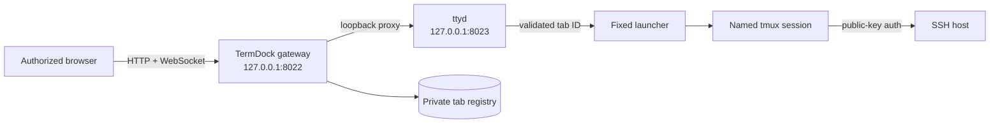

# TermDock

[](https://github.com/Encapsulate/termdock/actions/workflows/ci.yml)
[](https://www.python.org/)
[](LICENSE)

**Persistent, multi-tab SSH workspaces in your browser.**

TermDock turns a Linux host into a private browser-based SSH workspace. Every
browser tab maps to an independent tmux session on the server, so shells keep
running when you close the page, change devices, lose the network, or restart
the TermDock service. Return later and reattach exactly where you left off.

The interface is intentionally terminal-first: use **Alt+1** through **Alt+9**
to jump between workspaces and **Alt+0** for workspace 10. If the requested tab
does not exist, TermDock creates every missing slot, opens the requested SSH
session, focuses its xterm input, and leaves it ready to type.

TermDock is self-hosted, contains no telemetry or third-party browser assets,
and defaults to loopback-only networking.

## Highlights

- **Durable sessions:** one named tmux session per terminal tab.
- **Instant switching:** visited terminal views stay connected and switch
  without tearing down their WebSockets.
- **Keyboard-native workflow:** Alt+1–9 and Alt+0 work even while xterm has
  keyboard focus.
- **Automatic tab creation:** Alt+4 from a one-tab workspace creates tabs 2–4,
  selects tab 4, and focuses it.
- **Phone-friendly terminal:** two-finger drag scrolls xterm history without
  taking over ordinary one-finger taps, and the layout follows the visual
  viewport when Android's software keyboard opens.
- **Deep, application-proof scrollback:** xterm and tmux retain up to 100,000
  lines, and the wheel scrolls pane history instead of an inner chat/TUI.
- **Permanent extra-key bar:** compact Ctrl and Alt latches plus immediate Tab
  and Clear keys stay directly below the terminal without stealing focus.
- **Reliable selection and copy:** mouse drags and one-finger phone drags select
  xterm text instead of disappearing into tmux mouse mode; Copy uses that selection.
- **Server-saved tab registry:** reopen the page from another authorized browser
  and see the same workspace list.
- **SSH key authentication:** the terminal launcher always uses a configured
  identity with batch-mode public-key authentication.
- **Private by default:** the public gateway and ttyd backend both bind to
  loopback unless you deliberately change the gateway binding.
- **Built-in access control:** scrypt-hashed HTTP credentials protect the UI,
  API, and terminal WebSockets.
- **No arbitrary command surface:** URL arguments may select only `main` or a
  validated 12-character hexadecimal tab ID.
- **Turnkey user service:** the installer creates a private virtual environment,
  configuration, state directory, and hardened systemd user unit.

## How it works



TermDock has four deliberately small layers:

1. **The browser UI** renders the saved tab strip, retains visited ttyd iframes,
   handles keyboard switching, and asks for confirmation before ending a shell.
2. **The authenticated gateway** serves static files and the tab API, enforces
   HTTP authentication and same-origin mutation markers, and proxies ttyd HTTP
   and WebSocket traffic without forwarding web credentials upstream.
3. **ttyd** supplies xterm.js and converts the browser WebSocket into a local
   pseudo-terminal. Its own listener remains on loopback.
4. **The launcher** accepts only a validated tab identifier, attaches or creates
   the corresponding tmux session, and runs one fixed OpenSSH command assembled
   as an argument vector—never through a shell.

## Persistence behavior

| Event | Browser view | SSH/tmux shell |
|---|---:|---:|
| Switch to another TermDock tab | stays connected | keeps running |
| Close or reload the browser page | disconnects | keeps running |
| Temporary network loss | reconnects when reopened | keeps running |
| Restart TermDock | reconnects when available | keeps running |
| Restart ttyd | reconnects when available | keeps running |
| Explicitly close a TermDock tab | closes | is intentionally ended |
| Reboot the Linux host | closes | ends unless you add separate tmux restoration |

TermDock does not claim to restore running processes after a host reboot. Tools
such as tmux-resurrect can save layouts and commands, but process-level reboot
restoration is outside this project's security and reliability boundary.

## Requirements

- A Linux host with systemd user services.
- Python 3.10 or newer, including `venv` support.
- [ttyd](https://github.com/tsl0922/ttyd) 1.7 or newer.
- tmux.
- OpenSSH client.
- An SSH server reachable from the TermDock host.
- A public key authorized for the target SSH account.

For the default localhost setup, the local machine also needs OpenSSH Server:

```bash
sudo apt install openssh-server
sudo systemctl enable --now ssh
```

Package names and service names vary on non-Debian distributions.

## Quick start

Clone the repository and run the installer as the ordinary Linux user who will
own the TermDock service:

```bash
git clone https://github.com/Encapsulate/termdock.git
cd termdock
./install.sh
```

The installer asks for:

- a web login username and a password of at least 12 characters;
- the SSH host, port, and user; and
- the private-key path used for SSH authentication.

For the default `127.0.0.1` target, the installer can create a dedicated Ed25519
key under `~/.config/termdock/ssh/` and append only its public key to the current
user's `~/.ssh/authorized_keys`. That authorization is restricted to loopback
sources and disables agent, port, and X11 forwarding. It intentionally permits
a PTY because an interactive terminal requires one.

After installation, open:

```text
http://127.0.0.1:8022
```

Log in with the web credentials you chose. The browser may present its native
HTTP authentication dialog; the password itself is not stored by TermDock.

### Verify the installation

```bash
systemctl --user status termdock.service
curl http://127.0.0.1:8022/healthz
journalctl --user -u termdock.service -n 50 --no-pager
```

The health endpoint intentionally returns only a minimal service status. The UI,
tab API, and terminal transport require authentication.

## Connecting to a remote SSH host

Authorize a key on the remote account first, then provide that private-key path
to the installer. TermDock uses these OpenSSH safety defaults:

- `BatchMode=yes`
- `IdentitiesOnly=yes`
- `PreferredAuthentications=publickey`
- a dedicated known-hosts file in TermDock's private state directory
- `StrictHostKeyChecking=accept-new`

The first successful connection records the remote host key. Later key changes
fail closed and must be investigated before editing the known-hosts file.

If TermDock is already installed, edit:

```text
~/.config/termdock/termdock.env
```

Then restart the gateway:

```bash
systemctl --user restart termdock.service
```

Changing the SSH target does not migrate existing tmux shells. Close old tabs or
use a different `TERMDOCK_SESSION_PREFIX` and `TERMDOCK_TMUX_SOCKET` to keep the
two workspaces distinct.

## Safe remote browser access

TermDock's built-in authentication does **not** encrypt HTTP traffic. Leave
`TERMDOCK_HOST=127.0.0.1` and use one of the following patterns.

### Option 1: SSH tunnel

From your client computer:

```bash
ssh -N -L 8022:127.0.0.1:8022 your-user@your-server
```

Then browse to `http://127.0.0.1:8022`. The browser traffic travels inside the
SSH tunnel and TermDock remains unreachable directly from the network.

### Option 2: Caddy with HTTPS

```caddyfile
terminal.example.com {
    reverse_proxy 127.0.0.1:8022
}
```

Caddy handles WebSocket upgrades automatically. Keep TermDock's own login
enabled even if the reverse proxy adds another authentication layer.

### Option 3: nginx with HTTPS

```nginx
map $http_upgrade $connection_upgrade {
    default upgrade;
    '' close;
}

server {
    listen 443 ssl http2;
    server_name terminal.example.com;

    # Configure a valid certificate and modern TLS policy here.

    location / {
        proxy_pass http://127.0.0.1:8022;
        proxy_http_version 1.1;
        proxy_set_header Host $host;
        proxy_set_header X-Forwarded-Proto https;
        proxy_set_header Upgrade $http_upgrade;
        proxy_set_header Connection $connection_upgrade;
        proxy_read_timeout 1d;
    }
}
```

Do not proxy directly to port 8023. That is the unauthenticated ttyd backend and
must remain loopback-only behind TermDock.

## Keyboard and tab controls

| Control | Action |
|---|---|
| Alt+1 … Alt+9 | Select terminal 1 … 9 |
| Alt+0 | Select terminal 10 |
| Missing Alt-number target | Create missing tabs, select the requested one, focus xterm |
| `+ New terminal` | Create and select the next terminal |
| `Reconnect view` | Reload only the active ttyd view; the shell remains in tmux |
| `×` on a tab | Confirm, then end that tab's tmux session |
| Mouse wheel or two-finger vertical drag | Scroll persistent tmux pane history, including behind a full-screen TUI |
| Mouse drag or one-finger drag across terminal text | Create a persistent browser selection, even while tmux mouse mode is active |
| Ctrl or Alt button | Latch that modifier for the next typed key; tap again to cancel |
| Tab button | Send Tab, including a currently latched Ctrl or Alt modifier |
| Copy button | Copy the active terminal selection to the browser clipboard |
| Clear button | Send Ctrl+L to redraw the current terminal screen |

The shortcut listener runs in the iframe window's capture phase so xterm cannot
consume Alt+number first. The handled keystroke is stopped before it can reach
the shell.

TermDock reserves the mouse wheel and a two-finger vertical drag for tmux pane
scrollback, even if a full-screen chat or TUI requests mouse events. One-finger
interaction is left to xterm for focusing, selecting, and typing. Scrolling
back to the bottom automatically leaves tmux copy mode and returns the wheel to
normal live-terminal behavior. Both tmux and xterm are configured for 100,000
lines; changing that limit does not retroactively recover lines already evicted
before the setting was enabled.

Tmux mouse mode normally captures a drag and clears its highlight on release.
TermDock distinguishes taps/clicks from drags: a simple tap or click is still
forwarded to the terminal application, while one-finger or mouse movement beyond
a small threshold activates xterm's browser-native selection path. The selected
text remains highlighted and can be copied with the Copy key or the browser's
normal copy command. Two fingers remain reserved for scrolling history.

The page also follows the browser's visual viewport rather than the full layout
viewport, keeping the terminal above an open Android software keyboard. On very
short viewports, the helper caption is hidden to preserve working terminal rows.

The permanent key bar sits immediately below the terminal. Ctrl and Alt show a
highlighted latched state and reset after the next key. Copy uses the active
xterm selection. Tapping a toolbar button does not take input focus away from
xterm, avoiding unnecessary Android keyboard close/reopen cycles. Clear is
equivalent to Ctrl+L; it redraws the shell screen but does not delete tmux
history, scrollback, commands, or the session.

## Configuration reference

The installer writes a mode-0600 environment file at
`~/.config/termdock/termdock.env`.

| Variable | Default | Purpose |
|---|---|---|
| `TERMDOCK_HOST` | `127.0.0.1` | Authenticated gateway bind address |
| `TERMDOCK_PORT` | `8022` | Authenticated gateway port |
| `TERMDOCK_TTYD_PORT` | `8023` | Private loopback ttyd port |
| `TERMDOCK_STATE_DIR` | `~/.local/state/termdock` | Registry and known-hosts directory |
| `TERMDOCK_WEB_USERNAME` | required | HTTP login username |
| `TERMDOCK_WEB_PASSWORD_HASH` | required | scrypt password hash; never plaintext |
| `TERMDOCK_TMUX_BIN` | discovered `tmux` | Optional explicit tmux path |
| `TERMDOCK_TTYD_BIN` | discovered `ttyd` | Optional explicit ttyd path |
| `TERMDOCK_SSH_BIN` | discovered `ssh` | Optional explicit OpenSSH path |
| `TERMDOCK_SSH_HOST` | `127.0.0.1` | SSH destination host |
| `TERMDOCK_SSH_PORT` | `22` | SSH destination port |
| `TERMDOCK_SSH_USER` | required | SSH destination user |
| `TERMDOCK_SSH_IDENTITY_FILE` | required | Private key read by OpenSSH |
| `TERMDOCK_SSH_KNOWN_HOSTS_FILE` | state directory | Isolated host-key database |
| `TERMDOCK_SESSION_PREFIX` | `termdock` | Prefix for named tmux sessions |
| `TERMDOCK_TMUX_SOCKET` | `termdock` | Dedicated tmux server socket name |
| `TMUX_TMPDIR` | private state subdirectory | Durable socket location across service restarts |

Generate a replacement web password hash without placing the password in shell
history:

```bash
~/.local/share/termdock/venv/bin/termdock-password
```

Paste the resulting hash into `TERMDOCK_WEB_PASSWORD_HASH`, then restart the
service. The hash is a salted scrypt derivation; it is still sensitive and the
configuration file should remain private.

## Files and privacy

| Path | Contents | Recommended mode |
|---|---|---:|
| `~/.config/termdock/termdock.env` | settings and web password hash | 0600 |
| `~/.config/termdock/ssh/` | optional generated localhost SSH key | 0700 / key 0600 |
| `~/.local/state/termdock/tabs.json` | tab IDs, names, timestamps | 0600 |
| `~/.local/state/termdock/known_hosts` | accepted SSH host keys | 0600 |
| `~/.local/share/termdock/venv/` | isolated application installation | user-private |

TermDock does not include analytics, telemetry, cloud APIs, external fonts,
CDNs, or third-party browser requests. Terminal bytes pass through the local
gateway and ttyd to the configured SSH connection. TermDock does not record
terminal contents.

The tab registry contains no SSH credentials or command history. Command history
and running processes belong to the remote shell and tmux session, subject to
their own configuration.

## Security model

TermDock is an interactive shell gateway. Its security boundary should be
treated accordingly.

### Protections included

- Loopback binding by default for both public gateway and ttyd.
- Authentication on HTML, assets, API calls, and WebSockets.
- Salted scrypt password hashes with constant-time comparison.
- Custom same-origin header required for state-changing API requests.
- No permissive CORS policy.
- Content Security Policy and restrictive browser security headers.
- Web credentials removed before requests are proxied to ttyd.
- Fixed SSH command assembled without a shell.
- Strict tab identifiers and bounded API routes.
- Private, atomically replaced tab registry.
- Dedicated known-hosts file and public-key-only batch authentication.
- systemd hardening and `KillMode=process` so service restarts detach rather
  than destroy tmux sessions.

### Boundaries and responsibilities

- HTTP Basic authentication needs TLS or an SSH tunnel on untrusted networks.
- Anyone with valid TermDock credentials can operate the configured SSH account.
- Root and the owning local Unix user can read TermDock configuration and keys.
- Browser extensions, endpoint malware, or a compromised SSH target are outside
  TermDock's protection boundary.
- The default `accept-new` host-key policy protects later connections but cannot
  authenticate an unseen host against an out-of-band fingerprint. Verify the
  first host key separately for high-risk deployments.
- TermDock is designed for a single trusted operator, not multi-tenant shell
  isolation or per-user authorization.

See [SECURITY.md](SECURITY.md) for vulnerability reporting.

## Service operations

```bash
# Status
systemctl --user status termdock.service

# Restart the web gateway and ttyd; tmux shells remain running
systemctl --user restart termdock.service

# Follow logs
journalctl --user -u termdock.service -f

# Stop accepting browser connections without intentionally killing tmux shells
systemctl --user stop termdock.service

# Inspect TermDock's dedicated tmux server
tmux -L termdock list-sessions
```

The service's `KillMode=process` and state-backed `TMUX_TMPDIR` are intentional.
The application handles ttyd shutdown, while the separate tmux server and its
reachable socket retain running shells across service restarts—even though the
systemd unit uses a private `/tmp`. Do not change the unit to
`KillMode=control-group` unless you explicitly want service stops to kill every
TermDock shell.

On a headless server where this user's systemd manager must run without an
interactive login, enable lingering once:

```bash
sudo loginctl enable-linger "$USER"
```

Review your distribution's user-service policy before enabling linger on a
shared system.

## Updating

From the source checkout:

```bash
git pull --ff-only
./install.sh
```

The installer upgrades the isolated virtual environment and rewrites the user
unit without putting private configuration into the repository. Review release
notes before upgrading a remotely exposed shell gateway.

## Backup and restore

Back up these private directories with permissions preserved:

```text
~/.config/termdock/
~/.local/state/termdock/
```

The configuration may include an SSH private key. Store backups encrypted and
do not add them to Git. Restoring the tab registry restores the visible tab list,
not processes lost to a reboot or destroyed tmux server.

## Uninstalling

```bash
./uninstall.sh
```

The uninstall script stops and removes the service unit but deliberately keeps
configuration, keys, state, and the virtual environment to avoid destructive
surprises. After reviewing them, remove those directories manually if desired.

If the installer created a localhost key, its public half remains in
`~/.ssh/authorized_keys`. Remove the line ending in `termdock-local` only after
confirming no TermDock installation still uses it.

## Troubleshooting

### The page opens but the terminal is blank

Check both the gateway log and the SSH command independently:

```bash
journalctl --user -u termdock.service -n 100 --no-pager
ssh -vv -i /path/to/key -p 22 user@host
```

Confirm the target accepts the key without a password. TermDock deliberately
uses `BatchMode=yes`; it will not expose an SSH password prompt in the browser.

### `REMOTE HOST IDENTIFICATION HAS CHANGED`

Do not simply delete the warning. Verify the host's new key through a trusted
channel. After confirming the change, remove only the obsolete entry from
`~/.local/state/termdock/known_hosts` with `ssh-keygen -R` and reconnect.

### Alt+number changes the browser or desktop instead

TermDock captures Alt+number while its page or xterm has focus, but a desktop
environment or browser policy can reserve a shortcut before web content sees it.
Change that operating-system shortcut or use the clickable tab strip.

### Terminal history will not scroll on a phone

Use a two-finger vertical drag inside the terminal. A one-finger drag remains
available to xterm and the browser for normal terminal interaction. Scrollback
is unavailable while a full-screen application has switched the terminal to
its alternate screen unless that application provides its own history.

### A tab reappears after being closed

The browser list is reconciled with live tmux sessions. Confirm the dedicated
session is gone with `tmux -L termdock list-sessions`. Avoid manually creating
sessions with TermDock's reserved prefix unless you want them discovered.

### The service starts, then exits

Run:

```bash
systemctl --user status termdock.service
journalctl --user -u termdock.service -n 100 --no-pager
```

Common causes are a missing executable, unreadable SSH identity, occupied port,
invalid environment value, or unavailable Python virtual environment.

## Development

```bash
python3 -m venv .venv
. .venv/bin/activate
python -m pip install -e '.[test]'
python -m compileall -q src tests scripts
pytest
```

Browser-facing changes should also be exercised against real ttyd and tmux
sessions. Unit tests cover authentication, CSRF enforcement, launcher validation,
registry behavior, private file modes, and core HTTP routes.

## Project status

TermDock 1.0 is intended for a single trusted operator on a Linux host. Bug
reports, focused pull requests, packaging improvements, and carefully reviewed
security hardening are welcome. See [CONTRIBUTING.md](CONTRIBUTING.md).

## License

TermDock is released under the [MIT License](LICENSE).
